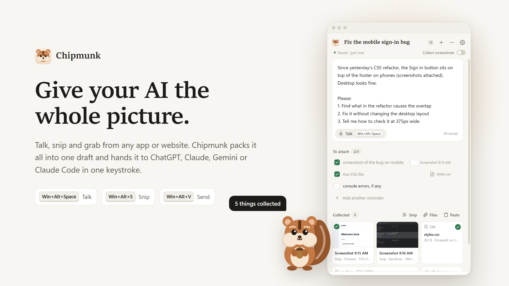
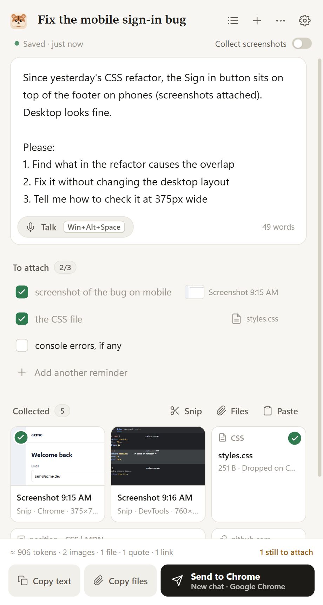
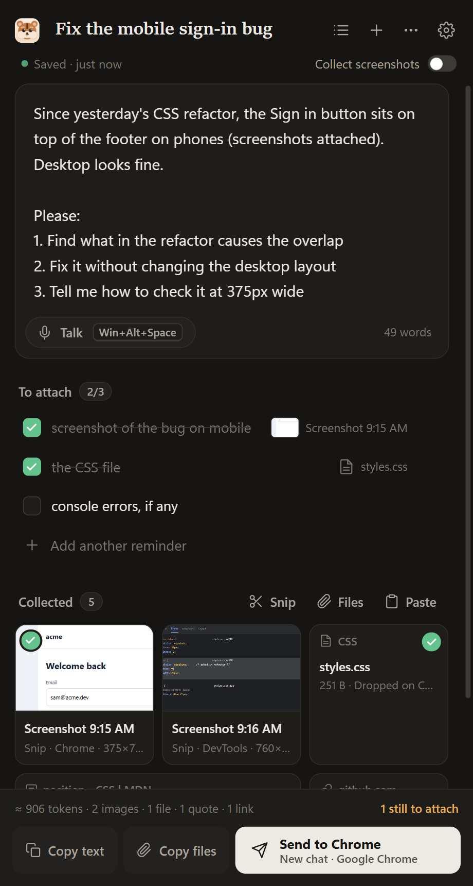

<p align="center">
  
</p>

<h1 align="center">Chipmunk</h1>

<p align="center">
  <b>Gather context from anywhere. Hand it to any AI in one keystroke.</b><br>
  Talk, snip and grab from any app or website. Chipmunk packs it into one draft that never gets lost,<br>
  then sends every screenshot, file and word to ChatGPT, Claude, Gemini, Cursor or Claude Code.
</p>

<p align="center">
  <a href="https://github.com/itsbsiddharth/chipmunk/releases/latest"><b>Download for Windows</b></a> ·
  <a href="#install">Install</a> ·
  <a href="#how-it-works">How it works</a> ·
  <a href="#use-it-with-coding-agents">Coding agents</a> ·
  <a href="#faq">FAQ</a>
</p>

---

## The problem

Your AI is only as good as the context you give it. Giving it context is still copy-paste chaos:

- You take four screenshots, find the error message, copy a paragraph from the docs and write your thoughts somewhere safe.
- Then you attach everything one by one, hoping the chat box doesn't eat your long prompt.
- A week later you want the same context somewhere else, and you do it all again.

**Chipmunk fixes that.** It collects everything into one draft as you work, and hands the whole bundle over in a single keystroke.

## How it works

**1. Collect, from anywhere**

| | |
|---|---|
| **Talk** | Press `Win+Alt+Space` and say your prompt. It lands in your draft. Uses Windows voice typing, or Wispr Flow, Aqua or any dictation app you already use. |
| **Snip** | `Win+Alt+S` snips part of your screen straight into the draft. No desktop full of PNGs. |
| **Grab** | Highlight text in any app and press `Win+Alt+C`. It's saved as a quote that remembers where it came from. |
| **Web** | Right-click any selection, image, link or page and choose **Add to Chipmunk**, or screenshot a whole tab. Works in Chrome, Edge and Brave. |
| **Chip** | A small chipmunk lives at the edge of your screen. Drop files, images, links or text on it. Its cheeks fill up as your draft does. |
| **Collect mode** | Flip it on and every screenshot you take the way you already do (Win+Shift+S, Print Screen, Ditto) is caught automatically. |

**2. Shape it**

- Write or dictate in a calm editor that **saves on every keystroke**. A version is kept every minute, and deleted drafts go to a trash you can undo.
- Keep a **To attach** list: write "screenshot of the error" and the next matching capture ticks it off. Chipmunk warns you before you send with something missing.
- Reorder attachments, or leave one out without deleting it. You see roughly how many tokens it all costs.

**3. Send**

- Click into ChatGPT, Claude, Gemini, Cursor or anything else and press **`Win+Alt+V`**. Every screenshot and file pastes in, then your text with its quotes and links. Your clipboard is put back afterwards.
- In a terminal running Claude Code, files go in as `@"path"` references, which Claude Code reads directly.
- Or let your coding agent **read the draft itself** (see below).

<p align="center">
  
  &nbsp;
  
</p>

## Use cases

- **Report a bug to Claude Code or Cursor.** Snip the broken screen, grab the error from the console, drop in the CSS file and say what you expected. Press `Win+Alt+V` in the terminal, or tell the agent "use my Chipmunk draft".
- **Research with ChatGPT or Gemini.** Right-click the paragraphs that matter on three different sites. Each quote keeps its source link, so the AI can cite it.
- **Design feedback.** Collect screenshots of the current UI and the reference you love, then talk through what should change.
- **Move a conversation to another AI.** Bring back a past Claude Code prompt, with its screenshots and the files it mentioned, and send it anywhere.
- **Write long prompts without fear.** Your draft lives on disk, not in a fragile chat box.

## Use it with coding agents

Chipmunk includes an [MCP](https://modelcontextprotocol.io) server, so agents can read your draft directly: text, screenshots as images, and file paths. Nothing needs pasting.

```bash
# Claude Code
claude mcp add --scope user chipmunk -- "C:\path\to\Chipmunk\Chipmunk.exe" --mcp

# Codex
codex mcp add chipmunk -- "C:\path\to\Chipmunk\Chipmunk.exe" --mcp
```

For Cursor, Claude Desktop and other MCP apps, add this to their MCP config:

```json
{ "mcpServers": { "chipmunk": { "command": "C:\\path\\to\\Chipmunk\\Chipmunk.exe", "args": ["--mcp"] } } }
```

Then just say **"use my Chipmunk draft"**. Chipmunk's **Settings → AI agents** shows these commands with your real path, ready to copy.

## Install

1. Download **`Chipmunk-win-x64.zip`** from the [latest release](https://github.com/itsbsiddharth/chipmunk/releases/latest) and unzip it anywhere, for example `C:\Apps\Chipmunk`.
2. Run **`Chipmunk.exe`**. Windows may say it "protected your PC", because the app isn't code-signed yet. Click **More info → Run anyway**.
3. Chip appears in the corner and a short welcome shows the shortcuts. That's it.

**Browser extension (optional, 30 seconds)**

1. Open `chrome://extensions` (or `edge://extensions`) and turn on **Developer mode**.
2. Click **Load unpacked** and pick the `extension` folder next to `Chipmunk.exe`.
3. Pin Chipmunk to your toolbar. It connects to the app by itself.

Needs Windows 10 or 11 with the Microsoft Edge WebView2 Runtime, which is built into Windows 11.

## Shortcuts

| Shortcut | Does |
|---|---|
| `Win+Alt+P` | Open or hide Chipmunk |
| `Win+Alt+Space` | Talk into your draft |
| `Win+Alt+S` | Snip part of the screen into the draft |
| `Win+Alt+C` | Grab the selection from any app |
| `Win+Alt+V` | Send the draft to the app you're in |
| `Alt+Shift+A` / `Alt+Shift+S` | In the browser: add the selection / screenshot the tab |

All shortcuts use `Win+Alt`, so they never clash with AltGr characters on international keyboards. If one is taken, Chipmunk picks a free alternative and tells you. Change any of them in **Settings**.

## Privacy

- Everything stays on your PC. Chipmunk makes no network requests and has no account, telemetry or cloud.
- Drafts are plain folders in `Documents\Chipmunk`: `prompt.md`, your files and a `draft.json`. You own them, and OneDrive or Dropbox can back them up.
- Clipboard entries that apps mark as private, such as passwords from a password manager, are never collected.
- Chipmunk's own clipboard use is hidden from Ditto and Windows clipboard history.
- The browser extension only talks to the Chipmunk app on your PC.

## FAQ

**Does it work with Wispr Flow?** Yes. Wispr Flow, Aqua, Superwhisper or Windows voice typing all type into Chipmunk's editor. Choose your dictation app in **Settings → Voice**, and the Talk shortcut puts your cursor in the draft for it.

**Does it upload my screenshots anywhere?** No. They only go to the AI app you paste into, the same as if you pasted them yourself.

**Do files get duplicated on disk?** Screenshots and small files are copied into the draft, so it still works if you move or delete the originals. Files over 25 MB are linked instead of copied.

**Mac?** Not yet. Chipmunk is Windows-first because that's where tools like this are missing.

**How do I bring back an old prompt?** Open **Drafts → Bring back a Claude Code prompt**, pick the session and the prompt, and it opens as a new draft with its screenshots and mentioned files.

## Build from source

```powershell
.\build.cmd        # needs the C# compiler from the free "Build Tools for Visual Studio"
```

The app ends up in `dist\`. To work on the interface in a normal browser with a stand-in for the Windows side, run `python tools\devserver.py` and open http://localhost:5178.

```
src\         C# app: window, tray, shortcuts, clipboard, paste engine, storage, pet, MCP server, browser bridge
ui\          the panel (HTML, CSS, JavaScript) rendered by WebView2
extension\   the Chrome / Edge / Brave extension
docs\        images for this README
```

## Roadmap

- Offline Whisper voice built in, with no dictation app needed
- macOS
- Insert drafts straight into web chats from the extension
- Shared drafts for teams

## License

MIT. Built with Microsoft WebView2 (see `lib/WebView2-LICENSE.txt`).
