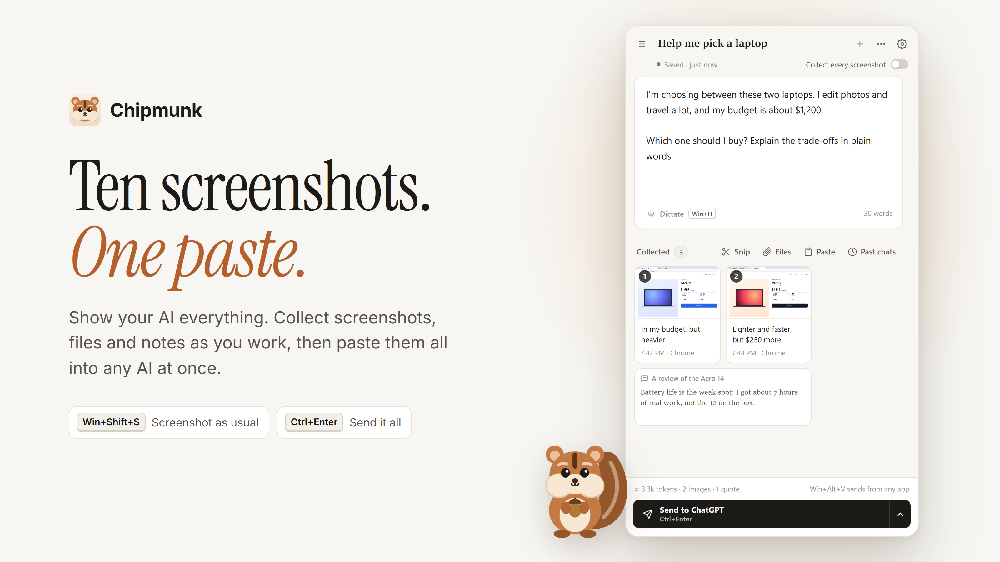
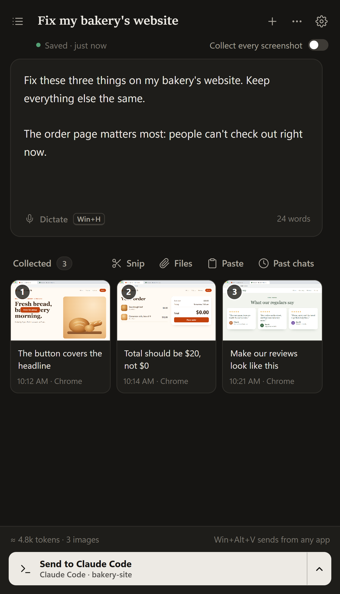
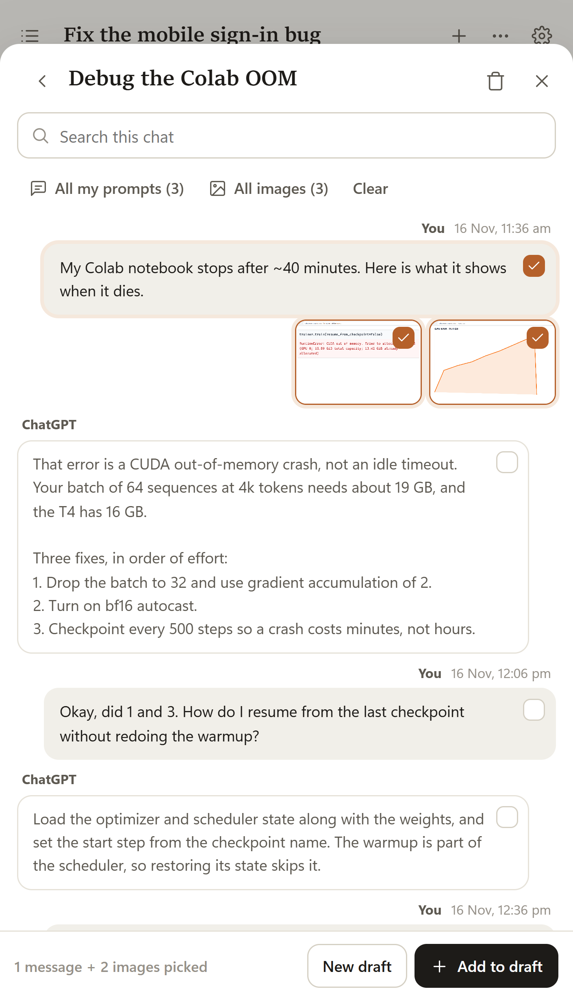

<p align="center">
  
</p>

<h1 align="center">Chipmunk</h1>

<p align="center">
  <b>Show your AI everything.</b><br>
  Screenshots, files and notes, into ChatGPT, Claude, Claude Code, Codex or Cursor in one paste.<br>
  Numbered, in order, with your notes attached.
</p>

<p align="center">
  <a href="https://chipmunk.bsid.dev"><b>Download for Windows</b></a> ·
  <a href="#install">Install</a> ·
  <a href="#how-it-works">How it works</a> ·
  <a href="#past-chats">Past chats</a> ·
  <a href="#use-it-with-coding-agents">Coding agents</a> ·
  <a href="#faq">FAQ</a>
</p>

---

## The problem

Your AI is only as good as the context you give it, and giving it context is still copy-paste chaos:

- You take four screenshots, find the error message, copy a paragraph from the docs and park your prompt in Notepad so the chat box can't eat it.
- Then you attach everything one by one, switching back and forth between apps.
- Next week you want the same prompt and screenshots in another chat, and you dig through old conversations to rebuild it.

On Windows it's worse with coding tools. Pasting screenshots into Claude Code, Codex or Cursor is unreliable: Ctrl+V or Alt+V, only one of several images attaching, images in the wrong order. Chipmunk pastes every image in order, or as `@file` paths for Claude Code in a terminal, every time.

**Chipmunk fixes that.** It collects everything into one draft as you work, lets you pull in pieces of any past chat, and hands the whole bundle to the AI you're using in one click.

## How it works

Three steps: **open it** (`Win+Alt+P`, or click Chip), **throw things in**, **send**.

**1. Collect, from anywhere**

| | |
|---|---|
| **Screenshots** | Take them the normal way (`Win+Shift+S`, Print Screen). While you're working on a draft (the panel is in front, or you used it in the last few minutes), each one lands in it by itself, with a number. Otherwise Chip asks "Add this screenshot to your draft?" and it takes one click. Your personal screenshots stay personal. To collect everything from any app, turn on **Collect every screenshot**: Chip shows a small glowing dot, and it turns itself off when you send. Windows still saves every screenshot to `Pictures\Screenshots`, and Chipmunk only copies from the clipboard, so nothing is taken out of that folder. |
| **Grab** | Highlight text in any app and press `Win+Alt+C`. It's saved as a quote that remembers where it came from. Copying from a browser keeps the page link with the quote. |
| **Paste / drop** | Paste text, images and files into the draft, or drop them on the panel. |
| **Past chats** | Pick prompts, replies and images from earlier Claude Code, Codex, Antigravity, ChatGPT, Claude or Gemini chats. [More below](#past-chats). |
| **Chip** | Drop files, images, links or text on the chipmunk at the edge of your screen. |

**2. Shape it**

- Type, or dictate with the app you already use: **Wispr Flow, Granola, Superwhisper, Aqua or Windows voice typing (`Win+H`)** all type straight into the draft. Chipmunk spots which one is running and shows its shortcut.
- **Notes.** Every screenshot shows a number (1, 2, 3), and each screenshot or file has a small **Add a note for the AI** field. When you send, the images paste first, in order, so the AI app numbers them Image 1, 2, 3 (Claude Code shows `[Image #1]`). Your notes go with them as "Image 2: your note". Labeling images this way is what Anthropic's own vision guide recommends. You can also just write "in image 2…" in the prompt. When a screenshot lands, a one-line confirmation ("Image 3 added to …") offers **Add a note** and **Undo**.
- The editor **saves on every keystroke**, keeps a version every minute, and deleted drafts go to a trash you can undo.
- Want a checklist? Open the **...** menu and choose **Add a reminder of what to attach**. Write "screenshot of the error" and the next matching capture ticks it off. Chipmunk warns you before you send with something missing.
- Reorder attachments, or leave one out without deleting it. You see roughly how many tokens it all costs.

**3. Send, without the back-and-forth**

- **Send** goes to the AI app you used last. The arrow next to it lists every open AI app and window (ChatGPT, Claude, Codex, Antigravity, Cursor, Claude Code in a terminal, a ChatGPT tab in Chrome) so you can pick another one. Chipmunk switches there and pastes every screenshot, file and word, then puts your clipboard back.
- The arrow menu also has **Copy the text** and **Copy images and files**, for when you want to paste by hand.
- Already in the app? Press **`Win+Alt+V`** and it all pastes right where you are.
- In a terminal running Claude Code, files go in as `@"path"` references, which Claude Code reads directly.
- Or let your coding agent **read the draft itself** ([see below](#use-it-with-coding-agents)).
- **Fresh draft after you send.** The next time you open the panel you get an empty draft, like a chat box. The one you sent stays in Drafts, and a toast offers **Open it**.

<p align="center">
  
  &nbsp;
  
  &nbsp;
  
</p>

## Meet Chip

Chip is the chipmunk that sits at the edge of your screen. It stays quiet unless it can save you a trip:

- **Click Chip to open your draft.**
- **Right-click Chip for the menu.** Send to any open AI app (each with its real icon), Snip, Past chats, **Collect every screenshot** and Hide Chip. Arrows, Enter and Esc work. The tray icon's menu adds New draft, **Show Chip**, Settings and Quit.
- **Drop anything on it** to collect it: files, images, links or text. Its badge counts the items in your draft.
- **You always know what's being collected.** When **Collect every screenshot** is on, Chip shows a small glowing dot and the tray tooltip says so.
- **It speaks up when it can help.** Switch to ChatGPT with a draft ready and Chip offers to paste it. Take a screenshot while you're not working on a draft and it asks "Add this screenshot to your draft?" One click, or ignore it and the bubble fades. If Chip is hidden and the panel is open, the panel shows the same question.
- **Never in your screenshots.** Chip and its bubbles don't appear in your screenshots or screen recordings.

Chip hides during fullscreen games, videos and presentations, and uses almost no CPU while idle. It's optional: the welcome screen asks whether to show it, and **Settings → Chip** turns it off, or just its suggestions.

## Past chats

You've already written great prompts and collected the right screenshots in earlier chats. Chipmunk lets you reuse any part of them:

<p align="center">
  
</p>

- **Claude Code, Codex and Antigravity** are read straight from their files on your PC. Nothing to set up.
- **ChatGPT (app or website) and Claude:** import the data export `.zip`. In ChatGPT go to Settings → Data controls → Export data. In Claude go to Settings → Privacy → Export data. Then pick the prompts, replies and images you want.
- **Gemini** shows up in Past chats once you've saved a Gemini chat with the [optional browser extension](#optional-browser-extension).
- Open a chat, tick the prompts, replies and images you want (from one chat or several), then **Add to draft** or start a **New draft**. Your prompts come back as editable text, replies as quotes, images as attachments. Claude Code prompts also bring back the files they mentioned with `@`.

## Use cases

- **Report a bug to Claude Code, Codex or Cursor.** Screenshot the broken screen, grab the error from the console, drop in the CSS file and say what you expected. Click Send and pick the agent.
- **Take a conversation to another AI.** Pull your best prompt and the screenshots from a ChatGPT chat, add Claude's answer from another chat, and send it all to Antigravity.
- **Research with ChatGPT or Gemini.** Copy the paragraphs that matter from three sites. Each quote keeps its source link, so the AI can cite it.
- **Design feedback.** Collect screenshots of the current UI and the reference you love, then dictate what should change.
- **Write long prompts without fear.** Your draft lives on disk, not in a fragile chat box.

## Use it with coding agents

Chipmunk includes an [MCP](https://modelcontextprotocol.io) server, so agents can read your draft directly: text, screenshots as images, and file paths. Nothing needs pasting.

```bash
# Claude Code
claude mcp add --scope user chipmunk -- "C:\path\to\Chipmunk\Chipmunk.exe" --mcp

# Codex
codex mcp add chipmunk -- "C:\path\to\Chipmunk\Chipmunk.exe" --mcp
```

For Antigravity, Cursor, Claude Desktop and other MCP apps, add this to their MCP config:

```json
{ "mcpServers": { "chipmunk": { "command": "C:\\path\\to\\Chipmunk\\Chipmunk.exe", "args": ["--mcp"] } } }
```

Then just say **"use my Chipmunk draft"**. **Settings → AI agents** shows these with your real path, ready to copy.

## Install

1. Download **`Chipmunk-Setup.exe`** (about 0.5 MB) from [chipmunk.bsid.dev](https://chipmunk.bsid.dev). Direct link: [Chipmunk-Setup.exe](https://github.com/itsbsiddharth/chipmunk/releases/latest/download/Chipmunk-Setup.exe). The short link [chipmunk.bsid.dev/download](https://chipmunk.bsid.dev/download) works too.
2. Open it. Windows may show "Windows protected your PC", because the app isn't code-signed yet. Click **More info**, then **Run anyway**.
3. Chip appears in the corner and the welcome shows the shortcuts. That's it.

The installer works for the current Windows user and needs no admin prompt. It puts Chipmunk in `%LOCALAPPDATA%\Programs\Chipmunk`, adds a Start menu shortcut and a desktop shortcut, and registers in Settings > Apps. Run it again to update in place.

Prefer not to install? Download the portable **`Chipmunk-win-x64.zip`** from the [latest release](https://github.com/itsbsiddharth/chipmunk/releases/latest), unzip it anywhere and run `Chipmunk.exe`.

Needs Windows 10 or 11 with the Microsoft Edge WebView2 Runtime, which is built into Windows 11. If a PC lacks it, the installer says so and offers a button to get it.

### Mac (beta)

1. Download **`Chipmunk-mac.zip`** from the [latest release](https://github.com/itsbsiddharth/chipmunk/releases/latest) and unzip it. Move **Chipmunk.app** to Applications.
2. The app isn't notarized yet, so the first time, right-click it and choose **Open**, then **Open** again.
3. Chipmunk sits in the menu bar. Click it to open your draft; right-click for **Send to**, Snip and more.
4. The first time you send, macOS asks to let Chipmunk paste for you: turn it on in **System Settings > Privacy & Security > Accessibility**.

On a Mac, screenshots you take with ⌘⇧3, ⌘⇧4 or ⌘⇧5 land in the draft while you're working on it, exactly as on Windows, and stay on your Desktop too. Shortcuts: `Ctrl+Option+P` opens Chipmunk, `Ctrl+Option+S` snips, `Ctrl+Option+C` grabs a selection, `Ctrl+Option+V` sends. The beta doesn't have Chip, Past chats, the browser extension or the MCP server yet. Drafts use the same folder format as Windows (`Documents/Chipmunk`).

### Updates

Chipmunk checks GitHub for a new release about once a day, when installed with the setup. When there's one, an **Update to X** pill appears in the panel, Chip offers it and the tray menu shows it. One click downloads the new setup and updates in a few seconds. To turn this off, clear **Keep Chipmunk up to date** in Settings.

### Uninstall

Open Settings > Apps > Installed apps > Chipmunk > Uninstall. Your drafts in `Documents\Chipmunk` are kept.

## Shortcuts

| Shortcut | Does |
|---|---|
| `Win+Alt+P` | Open or hide Chipmunk |
| `Win+Alt+S` | Snip part of the screen into the draft |
| `Win+Alt+C` | Grab the selection from any app |
| `Win+Alt+V` | Send the draft to the app you're in |
| `Ctrl+Enter` / `Ctrl+Shift+H` | In the panel: send / open Past chats |
| `Alt+Shift+A` / `Alt+Shift+S` | In the browser (with the extension): add the selection / screenshot the tab |

All shortcuts use `Win+Alt`, so they never clash with AltGr characters on international keyboards. If one is taken, Chipmunk picks a free alternative and tells you. Change any of them in **Settings**.

## Optional: browser extension

You don't need it. Copying from a browser already keeps the page link with the quote. The extension adds two things:

- Right-click any selection, image, link or page and choose **Add to Chipmunk**.
- **Save this chat** on ChatGPT, Claude and Gemini, one chat at a time. Handy for Gemini, and for single chats without a full export.

To install it (Chrome, Edge, Brave):

1. Open `chrome://extensions` (or `edge://extensions`) and turn on **Developer mode**.
2. Click **Load unpacked** and pick the `extension` folder. The installer puts it in `%LOCALAPPDATA%\Programs\Chipmunk\extension`. With the zip, it sits next to `Chipmunk.exe`.
3. Pin Chipmunk to your toolbar. It connects to the app by itself.

## Privacy

- Everything stays on your PC. Chipmunk has no account, telemetry or cloud.
- The daily update check is the only network request Chipmunk makes. It asks GitHub for the latest release. You can turn it off in Settings.
- Drafts are plain folders in `Documents\Chipmunk`: `prompt.md`, your files and a `draft.json`. You own them, and OneDrive or Dropbox can back them up.
- Past chats reads Claude Code, Codex and Antigravity history from their files on your PC and never changes them. ChatGPT and Claude chats come in only when you import an export. Browser chats are saved only when you click **Save this chat**.
- Clipboard entries that apps mark as private, such as passwords from a password manager, are never collected.
- Chipmunk's own clipboard use is hidden from Ditto and Windows clipboard history.
- The browser extension only talks to the Chipmunk app on your PC.

## FAQ

**Will it grab my personal screenshots?** No. Screenshots go into the draft by themselves only while you're working on it: the panel is in front, or you used it in the last few minutes. A panel that's just open behind other windows doesn't grab them. Otherwise Chip asks "Add this screenshot to your draft?" and it takes one click. **Collect every screenshot** is off unless you turn it on, and it turns itself off when you send.

**Does it take screenshots out of my Screenshots folder?** No. Windows still saves every screenshot to `Pictures\Screenshots`. Chipmunk only copies from the clipboard, so nothing is taken out of that folder.

**How do I point the AI at one screenshot?** Every screenshot has a number and an **Add a note for the AI** field. The AI app numbers the images Image 1, 2, 3 in the order they paste, and your notes go with them ("Image 2: the button is cut off"). You can also write "in image 2…" in your prompt.

**Do I have to use Chip? Will it clash with my Codex pet?** Chip is optional, with one switch in Settings, and the welcome screen asks whether to show it. It never appears in your screenshots and doesn't take any shortcut a pet uses. Many people run Chipmunk with Chip off and just press `Win+Alt+P`.

**Does it work with Wispr Flow?** Yes. Click in the prompt and use Wispr Flow as you always do; it types into the draft. The same goes for Granola, Superwhisper, Aqua and Windows voice typing.

**Can I get chats from the ChatGPT desktop app?** The app stores chats in your OpenAI account, not on your PC. Import your ChatGPT data export (Settings → Data controls → Export data) to bring in every chat at once. To save one chat at a time, open it on chatgpt.com and use **Save this chat** from the optional extension.

**Can I reuse just one prompt and a few images from an old chat?** Yes, that's what Past chats is for. Tick exactly what you want, even from different chats, and add it to your draft.

**Does it upload my screenshots anywhere?** No. They only go to the AI app you paste into, the same as if you pasted them yourself.

**Do files get duplicated on disk?** Screenshots and small files are copied into the draft, so it still works if you move or delete the originals. Files over 25 MB are linked instead of copied.

**Mac?** Yes, as a beta. See [Mac (beta)](#mac-beta).

## Build from source

```powershell
.\build.cmd        # builds the app into dist\
.\package.ps1      # builds dist\ plus release\Chipmunk-Setup.exe and release\Chipmunk-win-x64.zip
```

Building needs the C# compiler from the free "Build Tools for Visual Studio". To work on the interface in a normal browser with a stand-in for the Windows side, run `python tools\devserver.py` and open http://localhost:5178.

```
src\         C# app: window, tray, shortcuts, clipboard, paste engine, storage, Chip, past chats, MCP server, browser bridge
setup\       the installer (Setup.cs); the app files are embedded in it at package time
ui\          the panel (HTML, CSS, JavaScript) rendered by WebView2
extension\   the Chrome / Edge / Brave extension (optional)
site\        the website, https://chipmunk.bsid.dev
docs\        images for this README, source of the social card
```

## Website

The site at https://chipmunk.bsid.dev lives in `site\`. It is static HTML, CSS and JS, deployed on Vercel. `site\vercel.json` defines the short links `/download`, `/download/zip`, `/github` and `/releases`. The social preview image is rendered from `docs\og.html`.

## Roadmap

- Paste straight into web chats from the extension
- Search across every past chat at once
- macOS
- Shared drafts for teams

## License

MIT. Built with Microsoft WebView2 (see `lib/WebView2-LICENSE.txt`).
