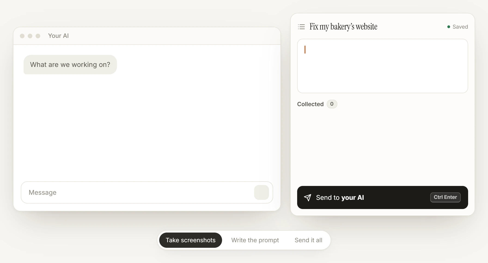
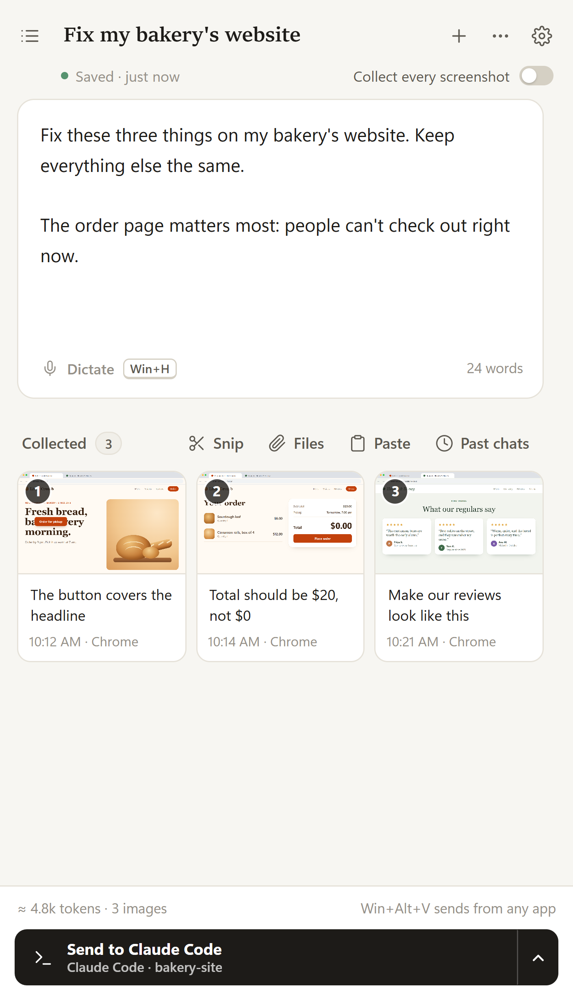
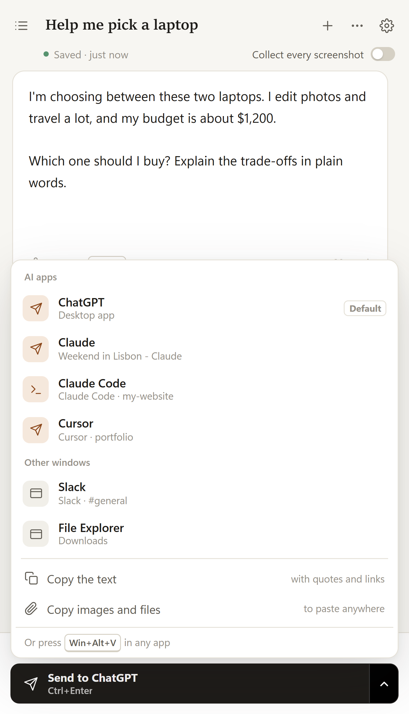

<p align="center">
  
</p>

<h1 align="center">Chipmunk</h1>

<p align="center">
  <b>Show your AI everything.</b><br>
  Screenshots, files and notes into ChatGPT, Claude, Claude Code, Codex or Cursor in one paste.<br>
  Numbered, in order, with your notes attached.
</p>

<p align="center">
  <a href="https://github.com/itsbsiddharth/chipmunk/releases/latest"></a>
  <a href="https://github.com/itsbsiddharth/chipmunk/releases"></a>
  
  
  <a href="LICENSE"></a>
</p>

<p align="center">
  <a href="https://chipmunk.bsid.dev/download"><b>Download for Windows</b></a>
  &nbsp;·&nbsp;
  <a href="https://chipmunk.bsid.dev/download/mac"><b>Download for Mac (beta)</b></a>
  &nbsp;·&nbsp;
  <a href="https://chipmunk.bsid.dev">Website</a>
</p>

<p align="center">
  
</p>

## Why

Giving an AI the full picture is still copy-paste chaos:

- You attach screenshots one by one, switching windows each time.
- In **Claude Code, Codex or Cursor on Windows**, pasting images is a coin flip: Ctrl+V or Alt+V, only one of several images attaching, images in the wrong order.
- The model can't tell your screenshots apart, so "the second one" gets misread.
- A long prompt is one refresh away from gone.

**Chipmunk fixes all four.** It collects everything into one draft while you work, numbers it, and pastes it into the AI you're using, in order, in one go.

## How it works

| | |
|---|---|
| **1. Screenshot as usual** | `Win+Shift+S` (or `⌘⇧4` on Mac). While you're working on a draft, each screenshot lands in it with a number. Your Screenshots folder keeps its copy. |
| **2. Say what matters** | Type or dictate your prompt. Add a note to any screenshot, or just write "in image 2…". |
| **3. Send** | `Ctrl+Enter`. Chipmunk switches to ChatGPT, Claude, Claude Code, Codex or Cursor and pastes the images in order, then your text with `Image 2: your note`. It puts your clipboard back afterwards. |

<p align="center">
  
  &nbsp;
  
  &nbsp;
  
</p>

## What you get

- **Numbered screenshots with notes.** The AI app numbers pasted images Image 1, 2, 3 (Claude Code shows `[Image #1]`). Chipmunk labels your notes with the same numbers, which is how [Anthropic's vision guide](https://platform.claude.com/docs/en/build-with-claude/vision) recommends pointing a model at one image among several.
- **Personal screenshots stay personal.** Only screenshots you take while working on a draft go in by themselves. Anything else, Chipmunk asks first. Turn on **Collect every screenshot** to catch everything; it switches itself off when you send.
- **Pastes into anything.** Desktop apps, browser tabs and terminals. Claude Code in a terminal gets `@"path"` file references, so images arrive every time.
- **Grab text from any app.** Highlight it and press `Win+Alt+C`. It's saved as a quote with its source link.
- **Reuse past chats.** Pick prompts, replies and images from earlier Claude Code, Codex, Antigravity, ChatGPT, Claude or Gemini chats ([how](#past-chats)).
- **Works with your dictation app.** Wispr Flow, Granola, Superwhisper and `Win+H` type straight into the draft.
- **Chip, if you want it.** A small chipmunk at the screen edge: click it to open your draft, drop files on it, and its badge counts what you've collected. It never shows up in your screenshots, and one switch turns it off.
- **Never lose a prompt.** Drafts save on every keystroke, keep a version every minute and live as plain files in `Documents\Chipmunk`.
- **Coding agents can read the draft directly** through a built-in [MCP server](#use-it-with-coding-agents).

## Install

**Windows 10 or 11.** Download [`Chipmunk-Setup.exe`](https://chipmunk.bsid.dev/download) (about 0.5 MB) and open it. It installs for your user account in seconds, with no admin prompt, and updates itself. Windows may say "Windows protected your PC", because the app isn't code-signed yet: click **More info**, then **Run anyway**. Prefer a portable copy? Get [`Chipmunk-win-x64.zip`](https://chipmunk.bsid.dev/download/zip).

**Mac (beta), macOS 13 or later.** Download [`Chipmunk-mac.zip`](https://chipmunk.bsid.dev/download/mac), unzip it and move **Chipmunk.app** to Applications. The first time, right-click it and choose **Open** (it isn't notarized yet). When you first send, allow Chipmunk in **System Settings > Privacy & Security > Accessibility** so it can paste for you. The Mac beta doesn't have Chip, Past chats, the browser extension or MCP yet.

<details>
<summary><b>More install details</b>: updates, uninstall, WebView2</summary>

- Chipmunk checks GitHub for a new release about once a day. When there's one, an **Update to X** pill appears; one click updates in a few seconds. Turn it off with **Keep Chipmunk up to date** in Settings.
- Uninstall from Settings > Apps > Installed apps > Chipmunk. Your drafts in `Documents\Chipmunk` are kept.
- Chipmunk needs the Microsoft Edge WebView2 Runtime, which is built into Windows 11. If a PC lacks it, the installer offers a button to get it.
- **Optional browser extension** (Chrome, Edge, Brave) adds right-click **Add to Chipmunk** and **Save this chat** on ChatGPT, Claude and Gemini. Open `chrome://extensions`, turn on **Developer mode**, click **Load unpacked** and pick `%LOCALAPPDATA%\Programs\Chipmunk\extension`. You don't need it: copying from a browser already keeps the page link.

</details>

## Shortcuts

| Windows | Mac | Does |
|---|---|---|
| `Win+Alt+P` | `Ctrl+Option+P` | Open or hide Chipmunk |
| `Win+Alt+S` | `Ctrl+Option+S` | Snip part of the screen into the draft |
| `Win+Alt+C` | `Ctrl+Option+C` | Grab the text you highlighted |
| `Win+Alt+V` | `Ctrl+Option+V` | Paste the whole draft into the app you're in |
| `Ctrl+Enter` | `⌘↩` | Send from the panel |

Change any of them in **Settings**. If a shortcut is taken, Chipmunk picks a free one and tells you.

## Past chats


Reuse any part of an earlier conversation: tick the prompts, replies and images you want, from one chat or several, and add them to your draft.

- **Claude Code, Codex and Antigravity** are read straight from your PC. Nothing to set up.
- **ChatGPT and Claude:** import your data export `.zip` (ChatGPT: Settings → Data controls → Export data; Claude: Settings → Privacy → Export data).
- **Gemini:** save a chat with the optional browser extension.

Your prompts come back as editable text, replies as quotes and images as attachments.

<br clear="right">

## Use it with coding agents

Chipmunk includes an [MCP](https://modelcontextprotocol.io) server, so agents can read your draft themselves: text, screenshots and file paths.

```bash
claude mcp add --scope user chipmunk -- "C:\path\to\Chipmunk\Chipmunk.exe" --mcp   # Claude Code
codex mcp add chipmunk -- "C:\path\to\Chipmunk\Chipmunk.exe" --mcp                 # Codex
```

Then say **"use my Chipmunk draft"**. **Settings → AI agents** shows these commands with your real path, plus the JSON for Cursor, Antigravity and Claude Desktop.

## Privacy

Everything stays on your computer. No account, no telemetry, no cloud. The only network request is the daily update check to GitHub, which you can turn off. Drafts are plain folders you own. Clipboard entries that password managers mark as private are never collected.

## FAQ

<details><summary><b>Will it grab my personal screenshots?</b></summary>

No. Screenshots go in by themselves only while you're working on a draft: the panel is in front, or you used it in the last few minutes. Otherwise Chipmunk asks first. **Collect every screenshot** is off unless you turn it on, and it switches itself off when you send.
</details>

<details><summary><b>Does it take screenshots out of my Screenshots folder?</b></summary>

No. Windows saves every screenshot to `Pictures\Screenshots` (and a Mac to your Desktop). Chipmunk keeps its own copy in the draft and never touches the original.
</details>

<details><summary><b>How do I point the AI at one screenshot?</b></summary>

Each screenshot has a number and a note field. The AI gets "Image 2: the button is cut off", matching the order the images were pasted. You can also just write "in image 2…" in the prompt.
</details>

<details><summary><b>Do I need Chip? Will it clash with my Codex pet?</b></summary>

Chip is optional (the welcome screen asks, and Settings has a switch). It takes no shortcuts and never appears in screenshots. Plenty of people use Chipmunk with Chip off and just press `Win+Alt+P`.
</details>

<details><summary><b>Does it work with Wispr Flow, Granola or Superwhisper?</b></summary>

Yes. Click in the prompt or a note and dictate as you always do; they type straight into Chipmunk.
</details>

<details><summary><b>Does it upload my screenshots anywhere?</b></summary>

No. They only go to the AI app you paste into, exactly as if you'd pasted them yourself.
</details>

<details><summary><b>Can I get chats from the ChatGPT desktop app?</b></summary>

Those chats live in your OpenAI account, not on your PC. Import your ChatGPT data export to bring them all in, or use **Save this chat** from the optional browser extension on chatgpt.com.
</details>

## Contributing

Issues and pull requests are welcome. Build steps, the project layout and how to test are in [CONTRIBUTING.md](CONTRIBUTING.md). Why the product works the way it does is in [docs/PRODUCT.md](docs/PRODUCT.md).

## License

[MIT](LICENSE). Built with Microsoft WebView2 (see `lib/WebView2-LICENSE.txt`).
